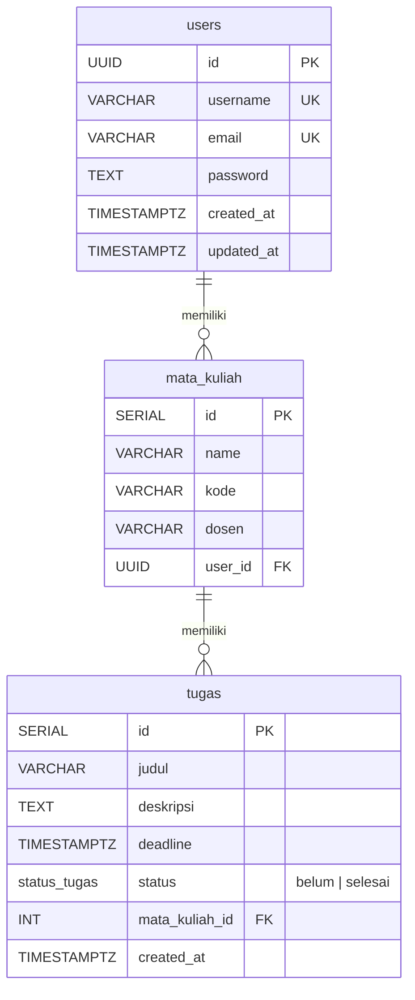

# ERD — StudyTrack

Relasi Modul 1 (users), Modul 2 (mata_kuliah), dan Modul 3 (tugas).

## Relasi

| Relasi | Kardinalitas | FK | On Delete |
|---|---|---|---|
| `users` → `mata_kuliah` | 1 : N | `mata_kuliah.user_id` → `users.id` | CASCADE |
| `mata_kuliah` → `tugas` | 1 : N | `tugas.mata_kuliah_id` → `mata_kuliah.id` | CASCADE |

## Catatan

- `tugas` tidak menyimpan `user_id`; kepemilikan tugas diturunkan lewat `mata_kuliah.user_id` (JOIN), sehingga tidak ada data ganda.
- `status_tugas` adalah enum PostgreSQL: `'belum'`, `'selesai'`.
- Fitur reminder deadline **tidak menambah kolom** — kategori (`mendekati` / `overdue` / `normal`) dihitung dari `deadline` dan waktu sekarang.
